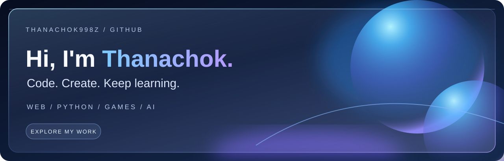
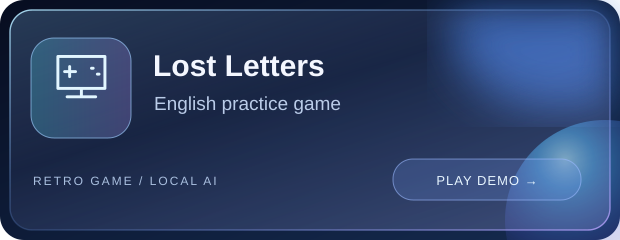
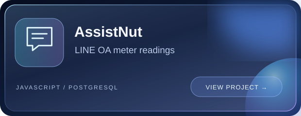
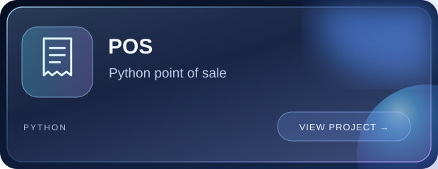
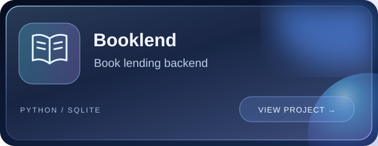

I build web apps, Python projects, games, and AI experiments. สนุกกับการเขียนโค้ด สร้างเกม และทดลองนำ AI มาใช้ในโปรเจกต์ต่าง ๆ

### Selected projects

[Lost Letters source code](https://github.com/Thanachok998z/Gamegrammar) · [All repositories →](https://github.com/Thanachok998z?tab=repositories)

### Tools in my projects

Code. Create. Keep learning.

