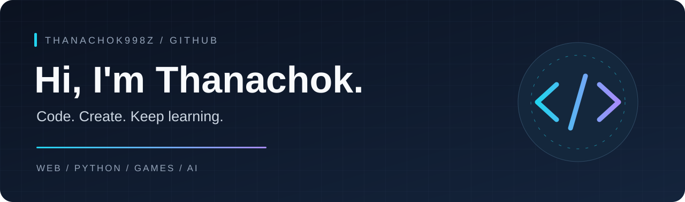

  

  
  

### Hello, I'm Thanachok 👋

I build projects across **web apps, Python, games, and AI experiments** — turning ideas into things people can try.

สวัสดีครับ ผมธนโชค สนุกกับการเขียนโค้ด สร้างเกม และทดลองนำ AI มาใช้ในโปรเจกต์ต่าง ๆ

---

### Selected projects

| Project | What it does | Explore |
| :--- | :--- | :--- |
| **🎮 Lost Letters** | An English practice game with a retro pixel style, plus a local AI edition using Ollama. | [Code](https://github.com/Thanachok998z/Gamegrammar) · [Play demo](https://thanachok998z.github.io/Gamegrammar/) |
| **💬 AssistNut** | A LINE OA project for submitting and confirming electricity meter readings, backed by PostgreSQL. | [View project](https://github.com/Thanachok998z/AssistNut) |
| **🧾 POS** | A Python point-of-sale project. | [View project](https://github.com/Thanachok998z/POS) |
| **📚 Booklend** | A Python backend project for book lending. | [View project](https://github.com/Thanachok998z/Booklend-back) |

### Tools in my projects

  
  
  
  
  
  

### Explore more

[All repositories →](https://github.com/Thanachok998z?tab=repositories)

Code. Create. Keep learning.

